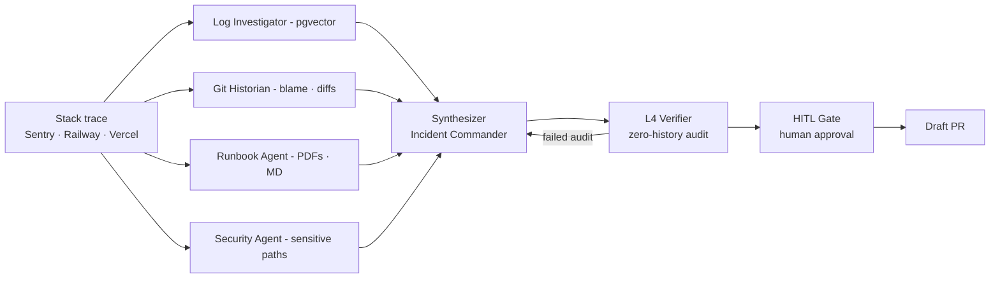

# SentinelSRE

**Autonomous incident & root-cause engineering.** SentinelSRE takes a production stack trace and turns it into a verified draft pull request — running a parallel multi-agent war room, synthesizing a root cause, and gating the fix behind a zero-history verifier and a human approval step.

## How it works

A single input, a single guarded output: a stack trace in, a verified hotfix PR out. Each stage is isolated, auditable, and either verified by software or gated by a human.



1. **Ingest** — paste a runtime stack trace or upload a log dump. Large dumps go straight to object storage, keeping the API request path small.
2. **Parallel investigation** — four specialist agents run in isolation: a log investigator searching semantically-indexed memory (pgvector), a Git historian inspecting blame and recent commits, a runbook agent consulting archived operational docs, and a security agent flagging sensitive paths.
3. **Synthesis** — an "Incident Commander" consumes the four independent findings into a single root-cause narrative plus a proposed patch.
4. **Verification** — an L4 verifier audits the proposed diff in complete isolation, checking it against the raw trace, the raw file, and structural invariants via Python AST parsing. This is the anti-hallucination layer.
5. **Human gate** — a human-in-the-loop gate sits on critical paths. Files touching auth, payments, or checkout require explicit approval before a PR is opened.

## Repository structure

```
frontend/              Next.js 16 app (App Router) — landing, dashboard, war room, auth, blog
  src/app/             routes: /, /dashboard, /blog, /sign-in, /sign-up
  src/components/      header, sidebar, war room, blog diagrams
  src/lib/             API client, SSE streaming, shared types
backend/               FastAPI service
  src/backend/api/     routers: health, auth, incidents, storage, knowledge, rules, analytics
  src/backend/services/ investigation, LLM calls, memory, storage, workspace, graph
  src/backend/models/   SQLAlchemy models (incidents, memory, knowledge files, traces, …)
  alembic/             database migrations
  tests/               pytest suite
docker-compose.yml      local Postgres (pgvector) + Redis + backend
DEPLOYMENT.md           full production runbook (Vercel + Render + Neon)
```

## Tech stack

| Layer | Technology |
| :--- | :--- |
| Frontend | Next.js 16, React 19, Tailwind CSS 4, Clerk |
| Backend | FastAPI, SQLAlchemy async, Alembic |
| Database | PostgreSQL with pgvector (Neon) |
| Cache / rate limit | Redis (optional Upstash) |
| Object storage | Cloudflare R2 (log dumps) |
| Streaming | Server-Sent Events for the war room |
| Agents | Parallel investigation + L4 verifier (multiple LLM providers) |

## Getting started

### Prerequisites

- Node.js 20+ and pnpm
- Python 3.12+ with uv (or pip)
- Docker (for Postgres/Redis)
- A Clerk application (frontend auth)

### 1. Clone and install

```bash
git clone git@github.com:Ashish-Zx/sentinel-sre.git
cd sentinel-sre

# Frontend
pnpm --dir frontend install

# Backend
cd backend
uv sync          # or: pip install -e ".[dev]"
cd ..
```

### 2. Bring up local infrastructure

```bash
docker compose up -d db redis
```

### 3. Configure environment

- Backend: copy `backend/.env.example` → `backend/.env` and fill in Clerk JWKS/issuer and at least one LLM API key (INCEPTION, OPENAI, or ANTHROPIC). Without an LLM key, investigation falls back to deterministic sampling.
- Frontend: copy `frontend/.env.example` → `frontend/.env.local` and add your Clerk publishable key/secret and `NEXT_PUBLIC_API_BASE_URL=http://localhost:8000`.

### 4. Run migrations and start servers

```bash
# Backend (port 8000)
cd backend
alembic upgrade head
uv run uvicorn backend.main:app --reload --port 8000

# Frontend (port 3000), in a second terminal
pnpm --dir frontend dev
```

Open [http://localhost:3000](http://localhost:3000). Sign up, upload a log to the Knowledge Vault, create an incident, and watch the war room stream.

## Scripts

| Command | Purpose |
| :--- | :--- |
| `pnpm --dir frontend dev` | Run the Next.js dev server |
| `pnpm --dir frontend lint` | ESLint on the frontend |
| `pnpm --dir frontend build` | Production build |
| `cd backend && uv run pytest` | Run the backend test suite |
| `docker compose up -d db redis` | Start local Postgres + Redis |

## Validation

`.github/workflows/ci.yml` runs on every push and pull request:

- backend `pytest` suite against a pgvector service container,
- backend Docker image build,
- frontend `pnpm lint` + `pnpm build`.

## Deployment

See [DEPLOYMENT.md](./DEPLOYMENT.md) for the production runbook: Next.js on Vercel, FastAPI on Render (Docker), Postgres on Neon, and optional Upstash Redis. Both `backend/.env` and `frontend/.env.local` are gitignored — never commit them.

## Documentation

The engineering blog lives in the app at `/blog` with posts on the [architecture](./frontend/src/app/blog/architecture/page.tsx), the parallel [war room](./frontend/src/app/blog/war-room/page.tsx), the zero-history [verifier & HITL gate](./frontend/src/app/blog/verifier-hitl/page.tsx), and [FinOps model routing](./frontend/src/app/blog/finops-routing/page.tsx).
