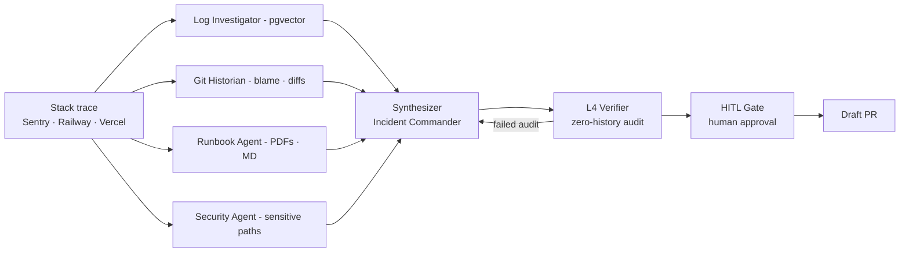
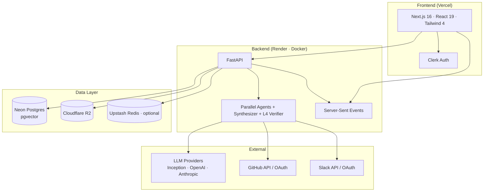

# SentinelSRE

**Autonomous incident & root‑cause engineering.** SentinelSRE turns a production stack trace into a *verified* draft pull request — orchestrating a parallel multi‑agent "war room," synthesizing a root cause, and gating every fix behind a zero‑history verifier and a human‑in‑the‑loop approval step.

> A single input, a single guarded output: **a stack trace in, a verified hotfix PR out.**

---

## Table of Contents

- [Highlights](#highlights)
- [Features](#features)
- [How it works](#how-it-works)
- [Architecture](#architecture)
- [Tech stack](#tech-stack)
- [Live deployment](#live-deployment)
- [Repository structure](#repository-structure)
- [Getting started (local)](#getting-started-local)
- [Environment variables](#environment-variables)
- [Configuration](#configuration)
- [Testing](#testing)
- [CI / CD](#ci--cd)
- [Security](#security)
- [Documentation](#documentation)
- [License](#license)

---

## Highlights

- ⚡ **Parallel independent investigation** — 4 specialist agents run in isolation and fan out over a single stack trace.
- 🛡️ **L4 zero‑history verifier** — an anti‑hallucination layer that audits the proposed diff against the raw trace and source.
- 👤 **Human‑in‑the‑loop (HITL) safety gates** — auth / payments / checkout paths always require explicit human approval.
- 🧠 **Semantic memory (pgvector)** — runbooks and past incidents are embedded and searched semantically.
- 📡 **Live SSE streaming** — watch the war room execute in real time.
- 🔌 **Provider‑agnostic LLM** — Inception (mercury‑3), OpenAI, or Anthropic.
- 🗂️ **Object storage uploads** — browser‑to‑R2 presigned uploads keep the API path small.
- 📊 **FinOps telemetry** — per‑agent cost/latency and savings analytics.
- 🔒 **Production‑grade auth** — Clerk (email/password + Google OAuth), per‑user GitHub/Slack connections.

---

## Features

### 1. Incident Ingestion
Paste a runtime stack trace or upload a log dump. Large dumps stream **directly to Cloudflare R2** via presigned URLs, so the API request path stays small and memory‑safe.

### 2. Parallel Investigation ("War Room")
Four specialists investigate the same crash **independently**:

| Agent | What it does |
| :--- | :--- |
| **Log Investigator** | Searches semantically‑indexed memory (pgvector) and past incidents for matching signatures. |
| **Git Historian** | Reads blame + recent commits via the GitHub API to find the offending change. |
| **Runbook Agent** | Consults archived operational docs (PDFs / Markdown) for established procedures. |
| **Security Agent** | Flags sensitive paths (auth, payments, migrations) and assesses blast radius. |

### 3. Synthesis
An **Incident Commander** consumes the four independent findings and produces a single cited root‑cause report plus a proposed unified diff.

### 4. L4 Verification (anti‑hallucination)
The verifier audits the proposed patch **in isolation**: it re‑reads the raw error, the raw file, and checks structural invariants via **Python AST parsing**. Failed audits are sent back to the synthesizer.

### 5. Human‑in‑the‑loop Gate
Any patch touching protected paths (`auth/`, `payments/`, `migrations/`, `checkout.py`) **pauses** the execution and requires explicit human approval before a PR is opened.

### 6. Delivery
On approval, the backend opens a **draft pull request** — using the user's connected GitHub account, or a shared fallback token — and optionally posts a notification to Slack.

### 7. Knowledge Vault
Upload architecture runbooks and crash logs (PDF / `.log` / `.md`). Files are stored in R2, chunked, embedded, and indexed into **pgvector** for semantic retrieval.

### 8. Procedural Memory
Team safety invariants — the minimum L4 confidence threshold and the list of protected file paths — are configurable per workspace and enforced by the HITL gate.

### 9. FinOps & Cost Telemetry
Per‑agent model routing data is recorded and surfaced as cost/latency and savings metrics, showing where frontier vs. fast tier models are used.

---

## How it works



1. **Ingest** — paste a stack trace or upload a log dump.
2. **Parallel investigation** — four isolated specialists gather evidence.
3. **Synthesis** — the Incident Commander writes the root‑cause narrative + proposed patch.
4. **Verification** — the L4 verifier audits the diff in a fresh, zero‑history context.
5. **Human gate** — protected paths require approval before the PR is opened.
6. **Delivery** — a draft PR is created, and Slack is notified.

---

## Architecture



---

## Tech stack

| Layer | Technology |
| :--- | :--- |
| Frontend | Next.js 16, React 19, Tailwind CSS 4, Clerk |
| Backend | FastAPI, SQLAlchemy (async), Alembic |
| Database | PostgreSQL with pgvector (Neon) |
| Cache / rate limit | Redis (optional Upstash) |
| Object storage | Cloudflare R2 (log dumps / runbooks) |
| Streaming | Server‑Sent Events (war room) |
| Auth | Clerk (email/password + Google OAuth) |
| Integrations | GitHub OAuth/API, Slack OAuth/webhooks |
| LLM | Inception (mercury‑3), OpenAI, Anthropic |

---

## Live deployment

| Component | URL / Provider |
| :--- | :--- |
| Frontend | **https://sentinelsre.live** (Vercel) |
| Backend | **https://sentinel-backend-ya71.onrender.com** (Render, free) |
| Database | Neon (free, Oregon) — pgvector enabled |
| Domain | `sentinelsre.live` (name.com → Vercel) |
| Auth | Clerk (production instance) |
| Keep‑warm | GitHub Actions cron pings `/api/health` every 10 min |

---

## Repository structure

```
├── frontend/                Next.js 16 app (App Router)
│   ├── src/app/             routes: /, /dashboard, /blog, /sign-in, /sign-up
│   ├── src/components/       header, sidebar, war room, blog diagrams
│   ├── src/lib/              API client, SSE streaming, shared types
│   └── vercel.json           Vercel framework/build config
├── backend/                 FastAPI service
│   ├── src/backend/api/      routers: health, auth, incidents, storage, knowledge, rules, analytics
│   ├── src/backend/services/ investigation, LLM, memory, storage, workspace, graph
│   ├── src/backend/models/   SQLAlchemy models
│   ├── alembic/             database migrations
│   ├── Dockerfile · entrypoint.sh · render.yaml
│   └── tests/               pytest suite
├── .github/workflows/
│   ├── ci.yml              tests + frontend build
│   └── keep-warm.yml       keep backend awake
├── docker-compose.yml       local Postgres (pgvector) + Redis + backend
├── DEPLOYMENT.md            production runbook
└── README.md
```

---

## Getting started (local)

### Prerequisites
- Node.js 20+ and pnpm
- Python 3.12+ with uv (or pip)
- Docker (for local Postgres/Redis)
- A Clerk application (for auth)

### 1. Install

```bash
git clone git@github.com:Ashish-Zx/sentinel-sre.git
cd sentinel-sre

# Frontend
pnpm --dir frontend install

# Backend
cd backend && uv sync && cd ..
```

### 2. Start local infrastructure

```bash
docker compose up -d db redis
```

### 3. Configure environment

- **Backend:** copy `backend/.env.example` → `backend/.env` and fill in
  Clerk JWKS/issuer and at least one LLM API key (`INCEPTION_API_KEY`,
  `OPENAI_API_KEY`, or `ANTHROPIC_API_KEY`). Without an LLM key, investigation
  falls back to deterministic sampling.
- **Frontend:** copy `frontend/.env.example` → `frontend/.env.local` and add
  your Clerk publishable key/secret and `NEXT_PUBLIC_API_BASE_URL=http://localhost:8000`.

### 4. Run migrations and servers

```bash
# Backend (port 8000)
cd backend
alembic upgrade head
uv run uvicorn backend.main:app --reload --port 8000

# Frontend (port 3000) — second terminal
pnpm --dir frontend dev
```

Open [http://localhost:3000](http://localhost:3000). Sign up, upload a log to the Knowledge Vault, create an incident, and watch the war room stream.

---

## Environment variables

### Backend (`backend/.env`)

| Variable | Description |
| :--- | :--- |
| `APP_ENV` | `development` or `production` |
| `DATABASE_URL` | asyncpg connection string (pooled for app) |
| `DATABASE_URL_UNPOOLED` | direct connection (migrations / dumps) |
| `CORS_ORIGINS` | JSON array of allowed browser origins |
| `CLERK_JWKS_URL` | Clerk JWKS endpoint |
| `CLERK_ISSUER` | Clerk issuer |
| `INCEPTION_API_KEY` / `OPENAI_API_KEY` / `ANTHROPIC_API_KEY` | LLM provider keys (any one) |
| `INCEPTION_BASE_URL`, `LLM_MODEL`, `LLM_TEMPERATURE` | Inception model config |
| `GITHUB_ACCESS_TOKEN` | shared fallback token for draft PRs |
| `GITHUB_DEFAULT_REPO` | fallback repo for PRs |
| `GITHUB_CLIENT_ID` / `GITHUB_CLIENT_SECRET` | per-user GitHub OAuth |
| `SLACK_WEBHOOK_URL` | shared Slack webhook fallback |
| `SLACK_CLIENT_ID` / `SLACK_CLIENT_SECRET` | per-user Slack OAuth |
| `ENCRYPTION_KEY` | Fernet key for encrypting user tokens |
| `R2_ACCOUNT_ID`, `R2_ACCESS_KEY_ID`, `R2_SECRET_ACCESS_KEY`, `R2_BUCKET`, `R2_ENDPOINT_URL` | Cloudflare R2 |
| `UPSTASH_REDIS_REST_URL`, `UPSTASH_REDIS_REST_TOKEN` | optional rate limiting |

### Frontend (`frontend/.env.local`)

| Variable | Description |
| :--- | :--- |
| `NEXT_PUBLIC_CLERK_PUBLISHABLE_KEY` | Clerk publishable key |
| `CLERK_SECRET_KEY` | Clerk secret key |
| `NEXT_PUBLIC_API_BASE_URL` | Backend base URL |
| `NEXT_PUBLIC_CLERK_SIGN_IN_URL`, `NEXT_PUBLIC_CLERK_SIGN_UP_URL` | routing config |

---

## Configuration

- **Clerk** — switch between development/production instances; add your domains to allowed origins & redirect URLs.
- **GitHub OAuth** — callback URL: `{BACKEND_URL}/api/github/callback`, scope `repo`.
- **Slack OAuth** — callback URL: `{BACKEND_URL}/api/slack/callback`, bot scopes `chat:write`, `channels:read`.
- **R2** — set bucket CORS to allow your frontend origin for direct uploads.
- **Rate limiting** — enable by setting the Upstash Redis vars (fail‑open when unset).

---

## Testing

```bash
# Backend
cd backend && uv run pytest

# Frontend
pnpm --dir frontend lint
pnpm --dir frontend build
```

---

## CI / CD

| Workflow | Trigger | Purpose |
| :--- | :--- | :--- |
| `ci.yml` | every push / PR | backend `pytest`, Docker build, frontend lint + build |
| `keep-warm.yml` | every 10 min | pings backend health to prevent free-tier cold starts |
| Render blueprint | push to `main` | auto-deploy backend |
| Vercel | push to `main` | auto-deploy frontend |

---

## Security

- Per-user GitHub/Slack tokens are encrypted at rest with `ENCRYPTION_KEY` (Fernet).
- Protected paths are gated behind mandatory human approval.
- The L4 verifier rejects hallucinated or unsafe diffs before they reach a human.
- Never commit `.env` files — they are gitignored; host secrets live in your provider dashboards.
- Rotate OAuth client secrets if they are ever committed to a public repository.

---

## Documentation

- [DEPLOYMENT.md](./DEPLOYMENT.md) — full production runbook
- `backend/README.md` — backend specifics
- `frontend/README.md` — frontend specifics
- `helper/SentinelSRE_Master_Plan.md` — original build plan

---

## License

Distributed under the MIT License. See `LICENSE` for details.

> Built with Next.js, FastAPI, Neon, and the Inception diffusion-LLM platform.
